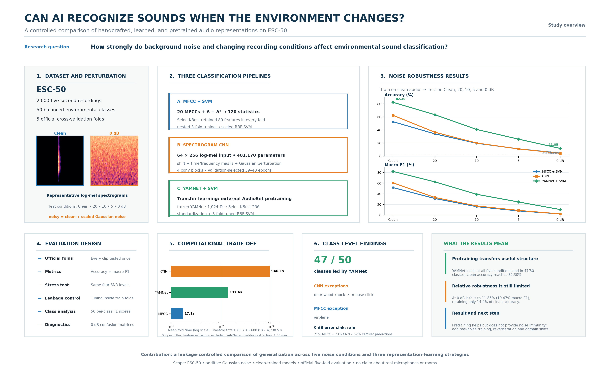

# Noise Robust ESC-50 Classification

This project evaluates how additive background noise affects environmental sound classification on the ESC-50 dataset. Three representation strategies are compared with the five official ESC-50 folds and the same Clean, 20 dB, 10 dB, 5 dB, and 0 dB evaluation conditions.

1. Enhanced MFCC, delta, and delta-delta statistics with feature selection and an RBF SVM
2. Log-mel spectrograms with an augmented convolutional neural network
3. Pretrained YAMNet embeddings with feature selection and an RBF SVM



## Main result

| Model | Clean accuracy | Clean macro-F1 | 0 dB accuracy | 0 dB macro-F1 |
|---|---:|---:|---:|---:|
| MFCC + SVM | 52.70% | 51.80% | 4.75% | 2.29% |
| Spectrogram CNN | 62.45% | 60.65% | 4.45% | 2.30% |
| YAMNet + SVM | **82.30%** | **82.18%** | **11.85%** | **10.47%** |

YAMNet with SVM performed best at every tested condition and achieved the highest clean-audio F1 score in 47 of 50 classes. However, it retained only 14.4% of its clean accuracy at 0 dB. The experiment therefore shows that external pretraining improves relative robustness but does not make environmental sound recognition noise-proof.

## Repository structure

```text
noise-robust-esc50-classification/
├── notebooks/
│   ├── 01_mfcc_svm.ipynb
│   ├── 02_spectrogram_cnn.ipynb
│   └── 03_yamnet_svm.ipynb
├── results/
│   ├── comparison/
│   ├── solution1_mfcc_svm/
│   ├── solution2_spectrogram_cnn/
│   └── solution3_yamnet_svm/
├── docs/
│   ├── ESC50_Final_Results_Comparison.docx
│   ├── ESC50_Graphical_Abstract.png
│   └── ESC50_Graphical_Abstract.svg
├── scripts/
│   └── download_dataset.ps1
├── RESULTS.md
├── requirements.txt
└── .gitignore
```

Only concise metrics, tables, and final figures are committed. The ESC-50 audio, virtual environments, feature caches, embeddings, trained models, intermediate Word reports, and QA renders are intentionally excluded.

## Dataset

[ESC-50](https://github.com/karolpiczak/ESC-50) contains 2,000 five-second recordings from 50 balanced environmental sound classes. The dataset supplies five official folds and is licensed separately under CC BY-NC 3.0.

### Download on Windows

```powershell
.\scripts\download_dataset.ps1
```

The expected dataset location is `data/ESC-50`.

## Environment

```powershell
py -m venv .venv
.\.venv\Scripts\Activate.ps1
python -m pip install --upgrade pip
python -m pip install -r requirements.txt
python -m jupyter lab
```

The YAMNet notebook was designed for Google Colab and downloads the pretrained TensorFlow Hub model at runtime. The first two notebooks can be run locally from the repository root or the `notebooks` directory.

## Experimental protocol

- Train on clean ESC-50 recordings.
- Use every official fold once as the held-out test fold.
- Perform feature selection and hyperparameter or epoch selection without using the outer test fold.
- Add deterministic Gaussian noise at 20, 10, 5, and 0 dB SNR.
- Report accuracy, macro-F1, class-wise F1, and confusion matrices.

The comparison is limited to additive Gaussian noise. It does not establish robustness to real background recordings, microphones, rooms, reverberation, codecs, or other domain shifts.

## Results and report

- [Complete results summary](RESULTS.md)
- [Final comparison document](docs/ESC50_Final_Results_Comparison.docx)
- [Graphical abstract PNG](docs/ESC50_Graphical_Abstract.png)
- [Combined machine-readable metrics](results/comparison/summary_metrics.csv)

